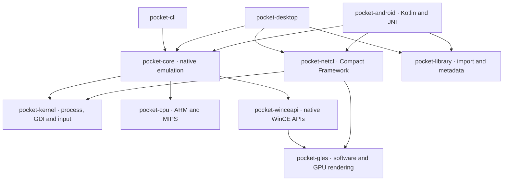

<!--
Copyright (C) 2026 PocketHLE Emulator Project
SPDX-License-Identifier: Apache-2.0 OR MIT
-->

# PocketHLE-Reborn detailed guide

[Back to the project overview](README.md)

## Compatibility evidence

> [!IMPORTANT]
> The screenshots above are representative game references supplied for the project presentation. The checked-in, reproducible emulator proof currently covers Asphalt 4 WVGA and Call of Duty 2's title-screen boot through the OpenGL ES layer. Zuma Deluxe and Bejeweled have game-specific compatibility work in the codebase, but should not be described as fully verified here without a corresponding checked-in run capture.

Additional compatibility probes and rendering captures are available under [`proof/`](proof), including Asphalt 2 3D, Crazy Taxi, Diamond Twister, Splinter Cell Conviction and other Windows Mobile titles.

The [maintainer's compatibility and test library](docs/COMPATIBILITY.md) lists
**87 PocketPC / Windows Mobile entries reported working** on 2026-11-12
and **57 Gizmondo entries**. It includes games, demos, benchmarks and utilities.

## Status

PocketHLE-Reborn can currently:

* import and unpack Windows Mobile `.CAB` archives;
* restore long filenames and installation paths from `_setup.xml`, or
  from the binary `MSCE` install header older cabinets use instead;
* select the intended game executable instead of helper binaries;
* load native ARM and MIPS PE images and inspect their imports;
* execute ARM code with the Unicorn Engine backend;
* intercept imported Windows CE DLL calls through HLE thunks;
* provide ordinal-to-name resolution for `coredll.dll` and `aygshell.dll`;
* emulate core windowing, GDI, GAPI, registry, filesystem, timing, input and audio paths;
* present GDI and GAPI software framebuffers, use host OpenGL by default for GLES 1.x with a PocketHLE-Reborn software fallback, and use host OpenGL for GLES 2.0;
* keep supported OpenGL ES frames on the GPU from rendering through desktop presentation, avoiding CPU pixel readback and re-upload;
* run a shared game library with per-game settings on desktop and Android;
* build Linux, Windows and Android artifacts through GitHub Actions.

The desktop frontend offers fullscreen (F12), screenshots (F10), video
recording (F11), and separate VSync and game FPS settings. Desktop and Android
offer global rendering options. Both GLES profiles support Native,
2×, 3× and 4× internal resolution, with a checkbox to include surfaces other
than 320×240 and 240×320. The Android frontend offers per-game settings,
orientation controls and on-screen controls. See the [frontend guide](docs/FRONTENDS.md) and
[GPU guide](docs/GPU.md) for platform-specific behavior.

Gizmondo profiles can use host Bluetooth Classic for supported RFCOMM workflows.
GTShell image transfer from Windows to Android is confirmed.

GPU-only presentation applies to compatible GLES frames. GDI composition,
software rendering, capture readback and unsupported sharing configurations
can use CPU pixels. The guest CPU still executes the game logic.

PocketHLE-Reborn is not a full Windows CE emulator. Some games still stop during CRT initialization, dynamic imports, worker-thread setup or unimplemented APIs. A successful boot or first frame does not automatically mean that an entire game is playable from start to finish.

## Architecture



Pocket PC applications with a supported managed entry point launch through
`pocket-netcf` on desktop and Android. It runs managed IL and implements a subset
of Compact Framework services, including Windows Forms and sensors. Managed games
use the same emulation view and OpenGL ES renderer as native games.
See [Compact Framework accelerometer support](docs/FRONTENDS.md#net-compact-framework-games).

When a native game starts:

1. `pocket-cab` extracts the archive and reconstructs its installed files and registry values.
2. `pocket-pe` parses the PE image, sections and imported symbols.
3. `pocket-kernel` maps the image, patches the import address table with HLE thunks and creates the guest process state.
4. `pocket-cpu` executes the guest ARM or MIPS code.
5. `pocket-winceapi` dispatches imported Windows CE calls to Rust handlers for graphics, files, windows, input, registry, timing and audio.
6. The selected frontend displays the framebuffer and forwards host input back to the guest.

## Using

Download a release archive for your platform, import a legally obtained Pocket PC
CAB or supported Windows installer, and choose the game in the desktop or Android
launcher. PocketHLE-Reborn extracts the Windows CE payload without running the Windows
setup program.

The Pocket PC importer supports these installer and archive families:

* standalone Windows CE CABs and supported embedded CABs in Windows executables;
* ZIP and ZIP self-extracting archives, plus supported RAR 3 self-extracting archives;
* InstallShield 5 and 6–13 cabinet sets, including supported InstallShield 5
  CabWiz INF layouts without a prebuilt CE CAB;
* NSIS installers, including supported solid and legacy bzip2 variants;
* legacy Inno Setup 2.0.11 installers with internal zlib payloads;
* supported Wise sequential DEFLATE, VISE ESIV and PocketSetup PS2 installers.

Support depends on the actual installer variant and its payload. Keep matching
header and volume files together in the archive when the installer uses a set.

For command-line runs:

```bash
# Inspect a cabinet
pockethle inspect-cab ~/Games/Asphalt4.cab

# Run a cabinet; the launcher extracts and mounts its install directory
pockethle run ~/Games/Asphalt4.cab

# Run with the real ARM CPU backend and capture frames
pockethle run ~/Games/Asphalt4.cab \
  --cpu unicorn \
  --dump-frames-to /tmp/pockethle-frames \
  --max-frames 8

# Inspect or run an extracted executable
pockethle pe-info /tmp/pockethle/Asphalt4.exe
pockethle run /tmp/pockethle/Asphalt4.exe --cpu unicorn
```

The CLI also supports `.exe` and `.zip` inputs. Use `--cpu stub` for trace-only and loader tests; it does not execute real game instructions.


### Steam Deck (Proton)

Use the **Windows archive** (`PocketHLE-Reborn-windows-x86_64.zip`) on Steam Deck.
Add `pockethle-gui.exe` as a non-Steam game, choose **Proton** or
**Proton Experimental** in the shortcut's Compatibility settings, and add this
to its **Launch Options**:

```text
--steam-deck
```

The Deck uses the same executable and update package as Windows; there is no
separate Steam Deck download. The argument selects the Deck controller/settings
profile. For updates, keep the existing Steam shortcut and back up your library
before replacing program files: its data may live inside the Proton prefix.
See the [Steam Deck guide](docs/STEAMDECK.md) for details.

## Build

Use the [build, signing and release guide](docs/BUILD.md) for pinned toolchains,
Linux/Windows prerequisites, Android/WSL2, static media, tests and public signing.
For a prepared source checkout with its dependencies installed:

```sh
cargo build --release --locked -p pocket-desktop
```

The [Steam Deck guide](docs/STEAMDECK.md) covers installation through Proton;
Deck uses the Windows package rather than a separate build. The
[documentation index](docs/README.md) routes settings, controls, graphics,
compatibility and diagnostics to their current owners.

## Library

Desktop and Android share the `pocket-library` model:

```
<library-root>/
├── library.json
├── config.json
└── games/
    └── <sanitized-id>/
        ├── game.json
        ├── source.cab
        └── extracted/
            └── ... game files ...
```

On Linux and Windows, the default library uses `Documents/PocketHLE-Reborn`
when available, or the platform data directory. On first use, PocketHLE-Reborn
renames an existing default `PocketHLE` folder if the new folder is absent.
If the rename fails, it keeps using the old path. If both folders already
exist, it opens `PocketHLE-Reborn` and leaves both folders intact.
`POCKETHLE_LIBRARY` still selects a custom path. Android keeps its existing
app-specific `library` directory.

## Roadmap

* complete the remaining CRT and legacy ARM startup paths;
* expand dynamic import and thread/runtime compatibility;
* improve resource, GDI and dialog coverage across more games;
* add broader gamepad, keyboard and touch mapping;
* continue improving audio mixing and host output;
* add reproducible compatibility captures for more titles;
* improve desktop and Android UX and diagnostics.

## Legal notice

PocketHLE-Reborn does not contain or distribute copyrighted Microsoft system DLLs, firmware or game assets. The Windows CE API layer is a clean-room reimplementation based on public API behavior and ordinal data. Users are responsible for the games and archives they provide.
